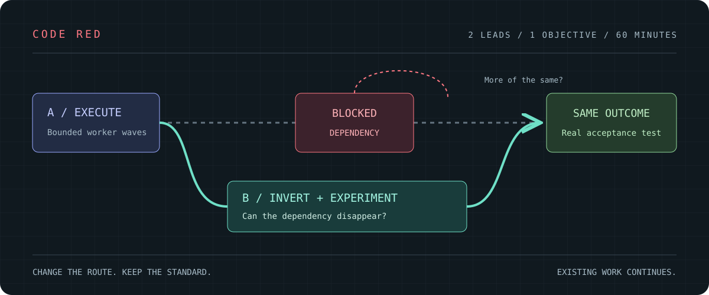

# Code Red

**Break the process trap. Find the route that finishes.**

[](LICENSE)
[](skills/code-red/SKILL.md)
[](skills/code-red/SKILL.md#the-four-hour-window)

## The job to be done

> **When my coding factory is busy but cannot finish, help me remove the process-created blockers and deliver the strongest verifiable result within four hours—with a one-hour permission checkpoint—without disrupting work already underway or weakening what “done” means.**

Agents can become exceptionally good at maintaining a process that no longer serves its purpose. A review requests another review. Verification needs infrastructure that needs verification. Each worker produces something, yet nothing reaches the user. The response is often more agents, more instructions, and more coordination around the same obstruction.

Code Red gives that situation a different operating mode: **two lead agents, four hours with a one-hour permission checkpoint, one objective, and a bounded pool of workers.** One lead drives execution while conserving scarce model credits. The other takes over the analytical burden and asks which assumptions, dependencies, or layers make the obstruction necessary in the first place.

The desired result is a working artifact with evidence. When the complete objective cannot fit, the result is an explicitly partial deliverable and exact next action—not another optimistic status report.



## What changes during Code Red

| Ordinary trap | Code Red move | Evidence that matters |
|---|---|---|
| Every task inherits the same plan | Give an independent worker the outcome and constraints, without the plan | A valid alternative that survives the same acceptance test |
| Add another prerequisite | Work backward and challenge the dependency edge | The required result is possible without that prerequisite |
| Run more checks that always pass | Attack the oracle with a meaningful negative control | An invalid result is rejected for the right reason |
| Maximize concurrent agents | Budget parallelism around the actual bottleneck | Useful artifacts arrive sooner without resource contention |
| Rewrite everything before delivering anything | Reuse valid output; change the boundary creating new debt | A concrete deliverable with honest provenance |
| Keep the orchestrator thinking about everything | Outsource deep analysis to a separately budgeted partner | A short, executable recommendation and its falsifier |

**Existing work is protected.** Agents outside the pair finish and land naturally. Code Red does not cancel their runs, overwrite their changes, reset proofs, or commandeer their resources.

## The move you might not think to try

The first wave includes a **blind subtraction experiment**. One worker receives the objective, real inputs, acceptance criteria, constraints, and occupied resources—but not the team's preferred architecture or diagnosis.

Its brief: *If you could write no new feature code, which dependency, handoff, conversion, queue, or layer could disappear while still producing the required result?*

The worker gets at most five minutes within the existing budget. The analyst then checks whether the proposed simplification actually removed work, merely moved its cost, or quietly changed the requirement. A passing demonstration is followed by the relevant negative case. A shortcut that fails the real oracle is rejected.

There is a reason to force this question. Across eight experiments, Adams and colleagues found that participants systematically overlooked beneficial subtractive changes under the tested conditions. Prompting subtraction can reveal options that normal improvement requests miss. This finding motivates the probe; it is not a performance guarantee for agents. [Study](https://pubmed.ncbi.nlm.nih.gov/33828317/)

## Four hours, two complementary minds

- **A: execution orchestrator.** Conserves scarce model credits and attention; assigns small jobs, collects artifacts, and integrates. A keeps working while B reasons.
- **B: inversion analyst.** Works backward, constructs failure scenarios, attacks assumptions, and designs cheap experiments. B is a thinking partner, not an approval queue.
- **Workers:** bounded independent tasks, with separate authorship and verification where required. Default ceilings are 32 jobs over the window and 8 concurrent workers, reduced by actual capacity and budget. More workers are useful only when they remove real independent work from the critical path.

The first few minutes establish the outcome and launch useful probes. The first hour builds toward a permission checkpoint: present delivered evidence, resource use, strongest counterevidence and the next plan, then ask the user to continue. The middle of the window tests alternatives and converges. The final stretch prioritizes verification and delivery. The absolute deadline survives handoffs, context resets, and the checkpoint approval. No automatic renewal; no silent definition-of-done change.

The full operating contract is [the skill](skills/code-red/SKILL.md). Ready-to-use [role prompts](skills/code-red/references/roles-and-messages.md) and a minimal [run card](skills/code-red/assets/run-card.md) keep coordination small.

## Before you start

You need two separate lead contexts; an execution harness and model that can delegate to subagents and collect their results; finite capacity/budget; authorized repository and test access; and one objective, acceptance oracle and a four-hour timebox with a one-hour permission checkpoint. A provider/model supplies reasoning, while a harness supplies tools, delegation and communication. Two different vendors are optional; shared quotas still count.

**Token efficiency never means silence.** Choose an operational A↔B channel for the actual harnesses. Native agent messaging, an orchestration bus, tmux with an existing herder adapter, cmux or another multiplexer plus a real transport, or protected computer use may serve. A multiplexer alone is not a mailbox. A saved ledger or a queued message does not establish that the other lead received a finding; Markdown cannot wake a suspended harness.

Before the clock, send a unique probe each way and obtain an explicit recipient acknowledgment. Agree a receipt/timeout owner, a response bound and a safe fallback. By default an actionable finding needs a response before the next affected decision or within five minutes, whichever is sooner; adjust the bound upfront to the task. B directly delivers each actionable finding with an ID, recommendation, strongest objection and cheapest falsifier. A returns **adopt, test, reject or defer**, with a reason and concrete owner/next step or exact checkpoint as applicable. Keep submission, delivery/readback, receipt, disposition and actual execution separate.

Batch routine updates; deliver decision-changing findings proactively. If a response misses its bound, inspect an ambiguous send before one safe fallback or concise named-owner escalation, deduplicating the ID. Protect drafts and valid runs, continue unrelated work, and never claim the loop works while receipt is unresolved. A cannot silence B to save tokens, and B does not become an approval gate for every A action. Use an existing harness/orchestrator timeout mechanism or agreed relay; do not spend the incident building communication tooling.

For a first run:

1. Load the skill in two separate contexts and assign A execution/B inversion using the [role prompts](skills/code-red/references/roles-and-messages.md).
2. Fill in the [run card](skills/code-red/assets/run-card.md) with the actual objective, oracle, inputs, authority, protected work, budget and recipients.
3. Verify worker capability and the reciprocal message probes; bind timeout/fallback ownership before starting the clock.
4. Start the clock, run bounded work, and directly notify the other lead when a finding changes a decision. A saved analysis needs an `updated path, please read` notice and an explicit disposition.

The [setup and communication recipe](skills/code-red/references/setup-and-communication.md) covers these checks and the lost-message fallback in detail.

## Intellectual roots

Code Red combines several traditions. “Inversion testing” is our name for this synthesis, not a claim that these thinkers founded one unified method.

- **Pappus and Pólya: reason backward from the solution.** Find what must precede success, then construct the route forward. [Pólya](https://www.tlu.ee/~tonu/modesimu/George_Polya_Mathematical_discovery.pdf)
- **Charlie Munger: invert failure, examine incentives, price alternatives.** Ask how to guarantee disaster, notice when the organization rewards the wrong output, and count the opportunity cost of continuing. Munger's speeches connect these habits to a broader lattice of models; this playbook selects relevant models rather than claiming to enumerate them all. [Collected speeches](https://www.stripe.press/poor-charlies-almanack/fullbook)
- **Popper and Feynman: seek the observation that defeats your explanation.** A successful test is evidence with boundaries; a team must expose facts that could invalidate its preferred story. [Popper](https://plato.stanford.edu/entries/popper/), [Feynman](https://calteches.library.caltech.edu/3043/1/CargoCult.pdf)
- **Meadows: intervene in goals, rules, and information flows.** Changing a number is sometimes weaker than changing the structure that keeps generating the problem. [Leverage Points](https://donellameadows.org/archives/leverage-points-places-to-intervene-in-a-system/)
- **Klein: imagine failure before it happens.** A premortem invites concrete explanations for a future failure while there is still time to act. [Premortem](https://www.gary-klein.com/premortem)
- **Subtractive and experimental traditions:** remove a component, preserve the outcome test, and discover which machinery was necessary. Negative controls, counterexamples, and reduction prevent an attractive shortcut from becoming self-deception.

The [playbook](skills/code-red/references/inversion-methods.md) turns these ideas into operational moves: when to use one, what to do, what evidence would defeat it, and where it can mislead.

## History that changes the question

**Software already has a subtractive tradition.** Unix pipes made small tools composable instead of demanding a custom monolith for every job. SQLite changed its test harness boundary to test where its previous harness could not readily run. Delta debugging reduced a Mozilla crash case from 95 actions to three and an HTML input from 896 lines to one. Each changed the shape of the problem before spending more effort on it. [Unix](https://www.nokia.com/bell-labs/unix-history/sohedid.html), [SQLite](https://sqlite.org/th3.html), [Delta debugging paper](https://issta16.cispa.saarland/papers/tse2002/)

**Science and engineering ask what must cross the difficult boundary.** Lunar-orbit rendezvous left much of the Apollo spacecraft in orbit and sent a specialized smaller craft to the surface. That removed mass from the hard leg while introducing rendezvous risks. The transferable question is: which part of our system actually needs to pass this expensive step? [NASA](https://www.nasa.gov/history/60-years-ago-nasa-decides-on-lunar-orbit-rendezvous-for-moon-landing/)

**Military maneuver offers an analogy, not a software proof.** At Cannae, Polybius describes Hannibal's yielding center and attacks on Roman flanks; the concentrated advance created exposure. At Vicksburg, Grant changed the approach, crossing below the city and moving inland before the eventual siege. Both invite a useful question: why are we attacking where the obstruction is strongest? Neither establishes that an indirect route is always better. [Polybius](https://sourcebooks.web.fordham.edu/ancient/polybius-cannae.asp), [National Park Service](https://www.nps.gov/vick/learn/historyculture/inland.htm)

More examples, including their limits, are in the [casebook](skills/code-red/references/casebook.md).

## How this project began

Code Red grew out of a multi-agent delivery effort in which coordination and verification had become obstacles to finishing. Under a fixed deadline, a constrained orchestrator delegated bounded artifacts while a second agent challenged the inherited route. The useful lesson was broader than any one task: preserve valid work, separate deep reasoning from scarce orchestration, and test whether the blocked dependency needs to exist.

This repository generalizes that experience into a portable playbook. It contains no private incident logs, account configuration, or project-specific operating rules. The origin story motivates the design; it is not a controlled evaluation of its effectiveness.

## Install the skill

Clone the repository, then copy `skills/code-red` into either personal skill directory. These commands assume the destination does not already exist; review an existing installation before replacing it.

```sh
git clone https://github.com/bradheitmann/code-red.git
cd code-red
mkdir -p "$HOME/.codex/skills" "$HOME/.claude/skills"
cp -R skills/code-red "$HOME/.codex/skills/code-red"
cp -R skills/code-red "$HOME/.claude/skills/code-red"
```

Alternatively, link both harnesses to one canonical copy to avoid drift. Reload skill discovery or use a new session if the running harness caches its catalog; do not interrupt an active team just to install.

**Codex:** invoke `$code-red`. **Claude Code:** invoke `/code-red`.

For Pi, OpenCode, Goose, Crush, or a harness using a DeepSeek-compatible provider, load or attach the same Markdown through that harness's existing instruction mechanism and verify its worker and communication capabilities. These are portable instruction-loading routes, not claims of tested native integrations. No other harness is installed or modified by this project. Installing text or connecting the MCP server does not supply an execution runtime.

Example:

> Use Code Red. Within four hours—with a one-hour permission checkpoint—deliver an installable candidate that reproduces the reported failure, fixes it, and passes the existing acceptance checks. Keep all current agents' work intact. Use the available worker budget; do not purchase additional capacity.

## npm package

The package contains the skill files and the compiled MCP server library:

```sh
pnpm add @bradheitmann/code-red
```

To install the skill from the package, copy `node_modules/@bradheitmann/code-red/skills/code-red`
to your harness's skill directory, using the same existing-installation precautions above.
Installing the package does not start a server or launch agents. For hosting and development,
use the source checkout and the server documentation.

## MCP distribution

The TypeScript server distributes the canonical playbook as MCP resources and a reusable prompt over Streamable HTTP. It does not run agents, execute code, store run records, or hold project credentials. Your connected agent harness performs the work under its own permissions and budget.

See [server documentation](server/README.md) for local development, deployment, and client configuration. The skill can also be used entirely from local files without the server.

## Contribute an asymmetric technique

A useful contribution identifies an obstruction, a different framing, a cheap test, the evidence that would refute it, and a boundary where it fails. Add a public source or a reproducible example. Distinguish observations from interpretation, keep failed experiments, and remove identifying details before sharing.

Code Red's ambition is to make blockage unnecessary. Its discipline is to demonstrate that the required result still exists after the blockage disappears.

[MIT license](LICENSE). Original text and diagrams are covered by this repository's license. Linked works retain their own copyrights; they are cited, not bundled or relicensed.
